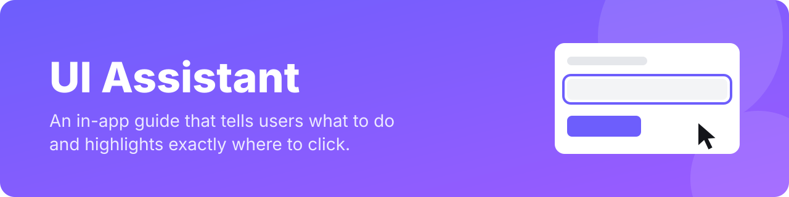
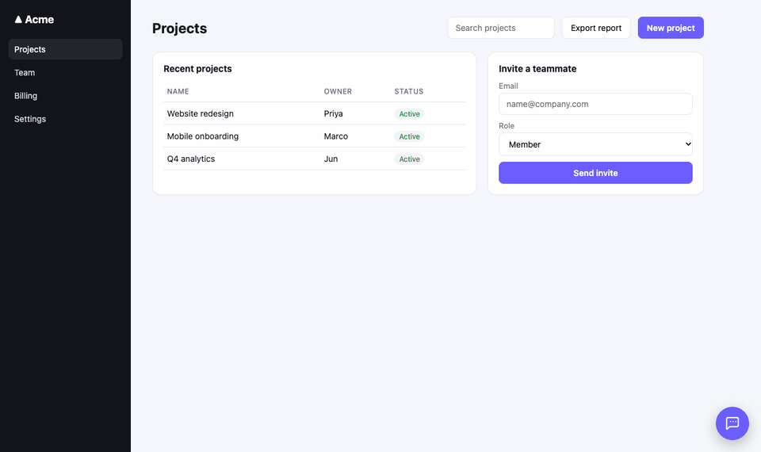
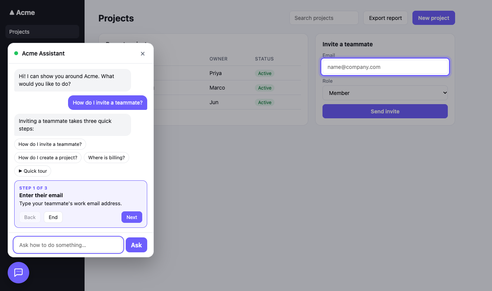
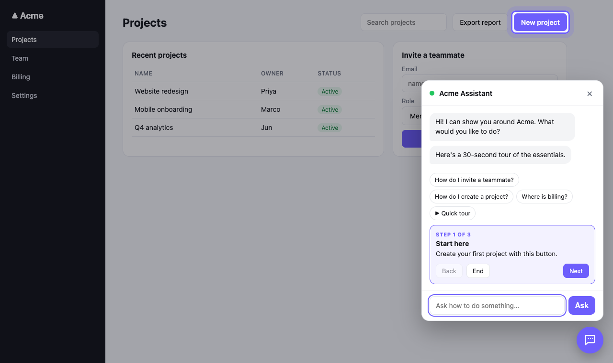
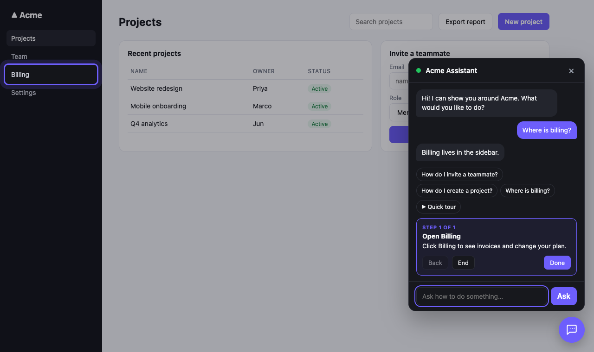
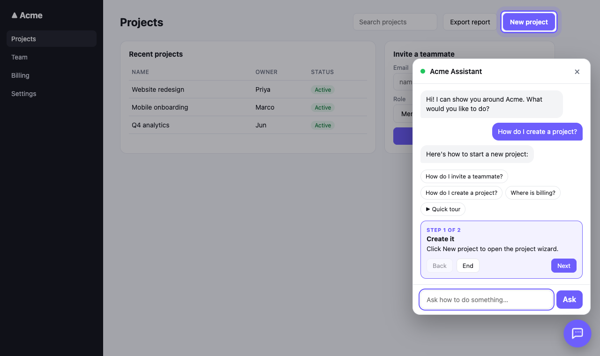
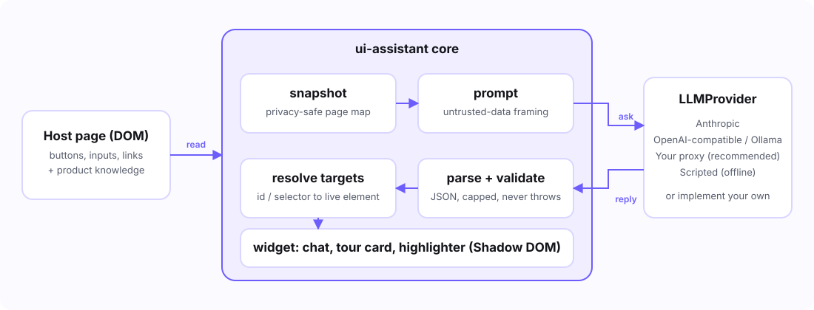

<p align="center">
  
</p>

<p align="center">
  <a href="https://github.com/tanujtp/ui-assistant/actions/workflows/ci.yml"></a>
  <a href="LICENSE"></a>
  
  
</p>

**UI Assistant** is a drop-in widget that lets anyone using your product ask *"How do I do this?"* and get step-by-step guidance **on the screen they are looking at**, with the exact button or field highlighted. Use it for onboarding, feature discovery, and ongoing in-app help, with any LLM or none at all.

<p align="center">
  
</p>

## Why

Product tours are brittle and static. Chatbots can explain but can't *show*. UI Assistant combines both:

| | Static tour libraries | Generic chatbots | **UI Assistant** |
|---|---|---|---|
| Answers free-form questions | No | Yes | **Yes** |
| Points at the real control on screen | Yes (hand-authored) | No | **Yes (generated)** |
| Adapts to the current page | No | No | **Yes** |
| Works without an LLM | Yes | No | **Yes (authored guides)** |
| Dependencies | Varies | Varies | **None** |

## Features

- **Ask anything.** Natural-language questions become short, ordered steps.
- **Highlights the real element.** A pulsing spotlight follows the control through scroll and resize; the panel moves out of the way automatically.
- **Authored guides.** Ship deterministic walkthroughs for critical journeys (no model, no cost, no surprises).
- **Bring your own model.** Anthropic, OpenAI, Ollama and any OpenAI-compatible server, your own backend proxy, or a scripted offline provider. Implementing the one-method `LLMProvider` interface takes minutes.
- **Private by design.** Typed values are never read; password and card fields are skipped; `data-uia-ignore` removes any region.
- **Advisory only.** The assistant never clicks or types for the user, which bounds the impact of prompt injection.
- **Accessible and isolated.** Shadow DOM styles, keyboard support, ARIA live region, light/dark/auto themes, reduced-motion support.
- **Tiny and typed.** Strict TypeScript, zero runtime dependencies, ESM + CJS + a script-tag build.

## Screenshots

<table>
  <tr>
    <td></td>
    <td></td>
  </tr>
  <tr>
    <td align="center"><sub>Free-form question → highlighted step</sub></td>
    <td align="center"><sub>Authored guide, no LLM required</sub></td>
  </tr>
  <tr>
    <td></td>
    <td></td>
  </tr>
  <tr>
    <td align="center"><sub>Dark mode follows the OS</sub></td>
    <td align="center"><sub>Context-aware answers</sub></td>
  </tr>
</table>

## Quick start

> The package is not published to npm yet. For now, clone the repo and run `npm run build`; the output in `dist/` is what `npm publish` will ship.

```ts
import { createAssistant, createProxyProvider } from "ui-assistant";

createAssistant({
  productName: "Acme",
  provider: createProxyProvider({ url: "/api/assistant" }), // your backend holds the API key
  knowledge: "Acme lets teams track projects. Invite teammates from Team > Invite. Billing is under Settings.",
  suggestions: ["How do I invite a teammate?", "Where is billing?"],
  guides: [
    {
      id: "welcome",
      title: "Quick tour",
      steps: [
        { target: "#new-project", title: "Start here", instruction: "Create your first project." },
        { target: "#invite", title: "Bring your team", instruction: "Invite collaborators." },
      ],
    },
  ],
});
```

Prefer a script tag? Load `dist/ui-assistant.iife.js` and use the global:

```html
<script src="/ui-assistant.iife.js"></script>
<script>
  UIAssistant.createAssistant({
    productName: "Acme",
    provider: UIAssistant.createProxyProvider({ url: "/api/assistant" }),
  });
</script>
```

### Try the demo (no API key needed)

```bash
git clone https://github.com/tanujtp/ui-assistant.git
cd ui-assistant
npm install
npm run dev     # http://localhost:5173
```

## Choosing a provider

| Provider | Use it for | Key stays private? |
|---|---|---|
| `createProxyProvider({ url })` | **Production.** Your server calls the model. | Yes |
| `createAnthropicProvider({ apiKey })` | Local development and demos. | No, key is in the browser |
| `createOpenAICompatibleProvider({ model, baseUrl })` | OpenAI, OpenRouter, vLLM, **Ollama** (`http://localhost:11434/v1`). | Only if no key or a proxy |
| `createScriptedProvider(rules)` | Offline demos, tests, FAQ fast-path. | n/a |

> **Never ship an API key in browser code.** Use the proxy provider in production. A copy-paste server is in [docs/proxy-server.md](docs/proxy-server.md).

Custom provider:

```ts
const provider: LLMProvider = {
  name: "my-model",
  async complete({ system, messages, signal }) {
    return await callMyModel(system, messages, signal); // return the model's text
  },
};
```

## Configuration

| Option | Type | Description |
|---|---|---|
| `provider` | `LLMProvider` | **Required.** Where answers come from. |
| `productName` | `string` | **Required.** Used in the prompt and welcome text. |
| `knowledge` | `string \| {title, content}[]` | Docs the model may use (capped at 8,000 chars). |
| `guides` | `Guide[]` | Authored walkthroughs shown as chips. |
| `suggestions` | `string[]` | Starter questions. |
| `position` | `"right" \| "left"` | Launcher side. Default `right`. |
| `theme` | `"light" \| "dark" \| "auto"` | Default `auto`. |
| `accentColor` | `string` | Any CSS color. |
| `snapshot` | `{ maxElements, requireLayout, ignoreSelector }` | Tune what the model sees. |
| `onError` | `(error) => void` | Hook for logging provider failures. |

Control it programmatically:

```ts
const assistant = createAssistant({ /* … */ });
assistant.open();
assistant.startGuide("welcome");
await assistant.ask("How do I export a report?");
assistant.destroy();
```

Helpful attributes on **your** markup:

- `data-uia-label="Invite button"` gives a control a clearer name for the model.
- `data-uia-ignore` hides a region (and everything in it) from the assistant.

## How it works

<p align="center"></p>

1. **Snapshot** the visible interactive elements, labelled and size-bounded, without reading any typed values.
2. **Prompt** the model with your product knowledge plus that snapshot, framed as untrusted data.
3. **Parse and validate** the JSON reply. Malformed output degrades to plain text; step counts and lengths are capped.
4. **Resolve** each step's target (element id or CSS selector) to a live DOM node. Hallucinated targets simply become text-only steps.
5. **Render** chat, step card and highlight inside a Shadow DOM.

Deeper dive: [docs/architecture.md](docs/architecture.md).

## Security and privacy

- Advisory only: no clicks, no keystrokes, no navigation performed for the user.
- Page content and knowledge are labelled untrusted in the prompt; model output is validated and rendered with `textContent` (no HTML injection).
- Password and `cc-*` fields are skipped; values are never serialized.
- Provider errors never include response bodies.

Found a vulnerability? See [SECURITY.md](SECURITY.md).

## Development

```bash
npm run typecheck   # strict TS
npm run lint
npm test
npm run build       # library -> dist/
npm run media       # regenerate README screenshots/GIF (needs Chrome + ffmpeg, dev server running)
```

## Roadmap

- [ ] Streaming responses
- [ ] Voice input
- [ ] Multi-page journeys that persist across navigation
- [ ] Analytics hooks (questions asked, steps completed)
- [ ] React / Vue wrappers

Ideas and PRs welcome. See [CONTRIBUTING.md](CONTRIBUTING.md).

## License

[MIT](LICENSE) © Tanuj Parmar
